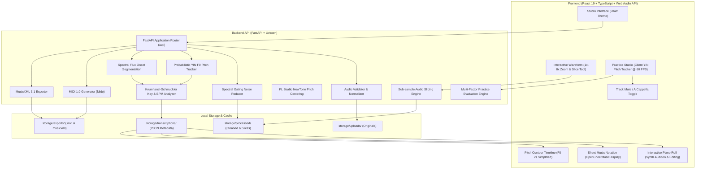

# 🎵 Practune — AI Music Analysis & Interactive Learning Studio

<p align="center">
  
  
  
  
  
  
  
</p>

---

## 🌟 Executive Summary

**Practune** is an AI-powered music analysis, audio processing, and interactive vocal learning workstation. It transforms raw audio recordings into structured, understandable musical intelligence.

Whether you are a singer practicing pitch precision, a musician transcribing melodies, or an audio engineer inspecting musical contours, Practune bridges digital signal processing with an intuitive, dark-themed DAW user interface running 100% locally on your machine with **zero external cloud subscriptions or paid APIs**.

---

## 🏗️ System Architecture & Data Flow



---

## 🚀 Key Modules & Capabilities

### 🎚️ Module A: Audio Import & Management
- **Universal Audio Support**: Import `WAV`, `MP3`, `FLAC`, and `OGG` files.
- **Drag-and-Drop & Instant Inspection**: Displays real-time audio statistics including duration, sample rate, bit depth, channel configuration, and peak levels.
- **Non-Destructive Slicing & Trimming**:
  - Two-click cut range selection (`✂ Set Cut Start` $\rightarrow$ `✂ Set Cut End`).
  - Floating visual canvas badges showing exact slice timestamps (`Start: X.XXs`, `End: X.XXs`, `Slice Duration`).
  - `✓ Apply Cut` performs sub-sample array slicing in Python, preserving the original audio untouched.
- **Waveform Zoom Engine**:
  - Zoom range from **100% (1x) to 800% (8x)** in fine increments.
  - Interactive mouse wheel zoom (`Ctrl + Wheel` / `Cmd + Wheel`).
  - Adaptive dynamic time-grid (subdivides down to 0.25s precision).
  - Synchronized playhead auto-scrolling during playback.
- **A/B Version Switcher**: Instantly compare original recordings with preprocessed or trimmed variations.

---

### 🎛️ Module B: Audio Preprocessing & DSP
- **Stationary Background Noise Reduction**: Spectral gating attenuation algorithms tuned for HVAC hum, ground loops, and microphone hiss without eating into rich musical harmonics.
- **Adjustable Intensity**: Slider control ranging from gentle attenuation (10%) to aggressive cleaning (100%).
- **Peak & Loudness Normalization**: Sets peak amplitude to **-1.0 dBFS**, maximizing signal-to-noise ratio and stabilizing pitch tracking thresholds.
- **Pre-Transcription Pipeline**: Select whether transcription runs on raw input or pre-cleaned audio.

---

### 🎼 Module C: Automatic Music Transcription
- **Vectorized YIN Fundamental Frequency Detection**: High-accuracy monophonic and dominant-melodic pitch tracking.
- **Spectral Flux Onset Detection**: Precise note segmentation separating individual musical transients.
- **Complete Note Extraction**: Each detected note encapsulates:
  - Musical Note Name & Octave (e.g., `C#4`, `A3`).
  - MIDI Pitch Value (e.g., `61`).
  - Start Time, End Time & Duration (in seconds).
  - Microtonal Pitch Deviation (in cents, e.g., `+14.2 cents`).
  - Detection Confidence Score (0.0 to 1.0).
- **Musical Key & Scale Detection**: Harmonic chroma correlation using the Krumhansl-Schmuckler profiles.
- **Tempo / BPM Estimation**: Calculates track pulse and estimated tempo.

---

### 🎚️ Module D: FL Studio NewTone Pitch Simplification
- **Pitch Center Quantization**: Intelligently attracts detected microtonal drift toward exact equal-tempered semitones without destroying melodic intention.
- **Pitch Variation Reduction**: Smooths vibrato, natural tremolo, and pitch jitter within sustained notes.
- **Non-Destructive Dual Data Model**: Keeps raw performance data intact while computing smoothed representation overlays in real time.

---

### 🎹 Module E: Interactive Multi-View Visualizations
- **Piano Roll Workstation**:
  - Horizontal timeline with pitch vertically mapped to a full 88-key piano keyboard.
  - Interactive note rectangles with duration resizing and note repositioning.
  - Built-in polyphonic Web Audio synthesizer for immediate note auditioning on click.
- **Continuous Pitch Timeline**:
  - Plots continuous $f_0$ contour trajectories overlaid on discrete note boundaries.
  - Real-time comparison between raw vocal pitch curves and NewTone-smoothed contours.
- **Standard Sheet Music Notation**:
  - Interactive score rendering powered by **OpenSheetMusicDisplay (OSMD)**.
  - Synchronized playhead cursor highlights the active note during playback.
  - Full support for exporting to **MusicXML 3.1** and **Standard MIDI (.mid)**.

---

### 🎤 Module F: Real-Time Vocal Practice Studio
- **Ultra-Low Latency Client Pitch Tracker**:
  - Real-time fundamental frequency tracking directly in the browser via Web Audio API at **60 FPS**.
  - RMS-based Voice Activity Detection (VAD) rejects ambient room noise and keyboard clicks.
- **Dual-Layer Pitch Comparison**:
  - Displays target melody blocks alongside your live singing trace.
  - Color-coded feedback in real-time: **Emerald** for in-tune notes ($\le \pm 50$ cents), **Amber** for flat/sharp drift.
- **Accompaniment Control & A Cappella Mode**:
  - Dedicated **Track Mute / Unmute icon button** (`Volume2` / `VolumeX`).
  - Practice singing with the original audio playing in your headphones, or mute the track to sing completely a cappella while the visual pitch tracker keeps scoring your voice.
- **Slow Practice Modes**: Time-stretched playback at **50%**, **75%**, or **100%** with formant/pitch preservation.
- **Key Transposition**: Adjust pitch by $\pm 12$ semitones to fit your comfortable vocal range.
- **Comprehensive Performance Evaluation Modal**:
  - **Overall Score**: Weighted composite calculation of Pitch, Timing, and Sequence accuracy.
  - **Pitch Accuracy**: Percentage of voiced frames landing within a $\pm 50$ cents tolerance window.
  - **Timing Accuracy**: Onset synchronization and note duration matching.
  - **Sequence Continuity**: Verification of pitch interval direction and melodic integrity.
  - **Intelligent Musical Coach**: Actionable text feedback pointing out specific flat/sharp notes and late entries.
  - **Note-by-Note Breakdown Table**: Granular evaluation of every individual note in the phrase.
  - **Fully Scrollable & Responsive**: Pinned sticky header and footer, dismissible via `Escape` key, backdrop click, or `Done` button.

---

## 🛠️ Technology Stack

| Layer | Technologies |
|---|---|
| **Frontend Framework** | React 19, TypeScript, Vite 6 |
| **Styling & UI** | Custom Glassmorphic DAW Dark Architecture, Tailwind CSS, Lucide Icons |
| **Audio Processing (Web)**| Web Audio API, Canvas 2D API, Client-Side YIN Algorithm |
| **Sheet Music Engine** | OpenSheetMusicDisplay (OSMD), MusicXML 3.1 |
| **Backend Framework** | Python 3.11+, FastAPI, Uvicorn (ASGI) |
| **DSP & Audio Math** | NumPy, SciPy, SoundFile, Noisereduce |
| **Music File Generation**| Mido (Standard MIDI File Format 1.0), MusicXML |
| **Architecture** | RESTful JSON API, Local File System Cache, Zero Cloud Lock-in |

---

## 💻 Installation & Setup Guide

### Prerequisites
- **Python**: Version `3.11` or higher ([python.org](https://www.python.org/))
- **Node.js**: Version `18.0` or higher ([nodejs.org](https://nodejs.org/))

---

### Step 1: Clone or Navigate to the Repository
```bash
git clone https://github.com/your-username/practune.git
cd practune
```

---

### Step 2: Backend Setup (Python / FastAPI)

#### On Windows (PowerShell):
```powershell
# Create virtual environment
python -m venv backend\venv

# Activate virtual environment
.\backend\venv\Scripts\Activate.ps1

# Install backend dependencies
pip install fastapi uvicorn python-multipart pydantic numpy scipy soundfile noisereduce mido
```

#### On macOS / Linux:
```bash
# Create virtual environment
python3 -m venv backend/venv

# Activate virtual environment
source backend/venv/bin/activate

# Install backend dependencies
pip install fastapi uvicorn python-multipart pydantic numpy scipy soundfile noisereduce mido
```

---

### Step 3: Frontend Setup (React / Vite)

```bash
# Navigate to the frontend directory
cd frontend

# Install dependencies
npm install

# Return to root directory
cd ..
```

---

## 🚀 Running Practune

To run the application, open two terminal windows:

### Terminal 1 — Backend API
```powershell
# Windows PowerShell
cd D:\practune
.\backend\venv\Scripts\Activate.ps1
uvicorn app.main:app --app-dir backend --host 127.0.0.1 --port 8000 --reload
```
```bash
# macOS / Linux
cd practune
source backend/venv/bin/activate
uvicorn app.main:app --app-dir backend --host 127.0.0.1 --port 8000 --reload
```
- API Root: `http://127.0.0.1:8000`
- Interactive Swagger Docs: `http://127.0.0.1:8000/docs`

---

### Terminal 2 — Frontend Studio
```bash
cd frontend
npm run dev
```
- Open your browser at: **`http://localhost:5173`**

---

## 🧪 Automated End-to-End Test Suite

Practune includes a comprehensive integration test script that generates a synthetic test audio file, uploads it, runs preprocessing, cuts an audio slice, tests pitch transcription, applies NewTone smoothing, simulates practice evaluation, and tests MIDI/MusicXML exports:

```powershell
# Run E2E Test Suite
.\backend\venv\Scripts\python.exe test_e2e_api.py
```

Expected output:
```text
==================================================
  PRACTUNE STUDIO — E2E TEST VERIFICATION SUITE
==================================================
[1/7] Testing API Health Check... SUCCESS!
[2/7] Generating synthetic audio & testing Upload... SUCCESS!
[3/7] Testing Audio Preprocessing (DSP Noise Reduction)... SUCCESS!
[4/7] Testing Audio Trimming / Slicing... SUCCESS!
[5/7] Testing Music Transcription (pYIN + Key/BPM)... SUCCESS!
[6/7] Testing FL Studio NewTone Pitch Simplification... SUCCESS!
[7/7] Testing Vocal Practice Evaluation & File Exports... SUCCESS!
==================================================
ALL E2E INTEGRATION TESTS PASSED PERFECTLY! (7/7)
==================================================
```

---

## 📡 RESTful API Reference

| Method | Endpoint | Description |
|---|---|---|
| `GET` | `/` | API welcome, health status & endpoint discovery |
| `GET` | `/api/health` | Service health status check |
| `POST` | `/api/audio/upload` | Multipart file upload for WAV, MP3, FLAC, OGG |
| `GET` | `/api/audio/list` | List all uploaded and processed audio tracks |
| `GET` | `/api/audio/{audio_id}/file` | Stream raw audio binary for playback |
| `POST` | `/api/audio/{audio_id}/trim` | Slice audio within start & end bounds |
| `POST` | `/api/audio/{audio_id}/preprocess` | Apply DSP noise reduction and peak normalization |
| `POST` | `/api/audio/{audio_id}/transcribe` | Execute F0 pitch tracking, note segmentation & key estimation |
| `POST` | `/api/audio/{audio_id}/correct` | Apply NewTone pitch centering & variation smoothing |
| `POST` | `/api/practice/evaluate` | Multi-factor vocal evaluation comparing pitch frames against notes |
| `GET` | `/api/audio/{audio_id}/export/midi` | Download standard Format 1 MIDI file (`.mid`) |
| `GET` | `/api/audio/{audio_id}/export/musicxml`| Download standard MusicXML 3.1 score (`.musicxml`) |

---

## ⌨️ Shortcuts & Interaction Guide

| Action | Control |
|---|---|
| **Waveform Zoom In / Out** | Click `+` / `-` buttons, or hold `Ctrl` + Mouse Wheel |
| **Waveform Reset Zoom** | Click `1x` button |
| **Slice / Cut Audio** | Click `✂ Slice Audio` $\rightarrow$ Click Waveform for Start $\rightarrow$ Click for End $\rightarrow$ `✓ Apply Cut` |
| **Audition Note** | Click any note block on the Piano Roll |
| **A Cappella Mode** | Click the `Volume2` / `VolumeX` icon during Practice Studio |
| **Close Modal** | Press `Escape` or click outside the modal overlay |
| **Transpose Key** | Click `+` / `-` semitone buttons in Practice Studio |
| **Playback Speed** | Select `50%`, `75%`, or `100%` buttons |

---

## 📂 Project Directory Structure

```text
practune/
├── backend/
│   ├── app/
│   │   ├── main.py                  # FastAPI application router & endpoints
│   │   ├── config.py                # Storage, upload dirs, and audio settings
│   │   ├── models/
│   │   │   └── schemas.py           # Pydantic data schemas
│   │   └── services/
│   │       ├── audio_service.py     # File I/O, format validation, waveform peaks
│   │       ├── dsp_service.py       # Noise reduction, loudness norm, slicing
│   │       ├── dsp_utils.py         # YIN F0 pitch tracking & onset detection
│   │       ├── pitch_transcription.py# Audio-to-note segmentation & key/BPM analysis
│   │       ├── pitch_correction.py   # NewTone-style pitch centering & variation smoothing
│   │       ├── practice_service.py   # Evaluation engine (cents tolerance, timing, feedback)
│   │       └── music_export.py       # MIDI (.mid) & MusicXML (.musicxml) generators
│   └── storage/                     # Local storage (uploads, processed, transcriptions, exports)
├── frontend/
│   ├── src/
│   │   ├── App.tsx                  # Main studio interface
│   │   ├── index.css                # Master DAW dark stylesheet & modal system
│   │   ├── components/
│   │   │   ├── Navbar.tsx           # DAW navigation header
│   │   │   ├── Dashboard.tsx        # Session library, dropzone, demo generator
│   │   │   ├── AudioWorkspace.tsx   # Waveform scrubber, zoom, cut tool, DSP controls
│   │   │   ├── PianoRoll.tsx        # Canvas DAW piano roll with synth audition & editing
│   │   │   ├── PitchTimeline.tsx    # Continuous F0 pitch contour vs simplified melody
│   │   │   ├── SheetMusicView.tsx   # Musical notation staff & MusicXML renderer
│   │   │   ├── PitchCorrectionControls.tsx # FL Studio NewTone sliders
│   │   │   ├── PracticeStudio.tsx   # Live dual-layer pitch tracker & mute toggle
│   │   │   ├── EvaluationModal.tsx  # Scrollable score breakdown, note table, confetti
│   │   │   └── SettingsModal.tsx    # Practice tolerance & DSP thresholds
│   │   ├── services/
│   │   │   ├── api.ts               # Backend API client
│   │   │   ├── synth.ts             # Web Audio polyphonic synthesizer
│   │   │   └── micPitchTracker.ts   # 60 FPS client-side YIN pitch detector
│   │   └── types/index.ts           # TypeScript type definitions
│   └── package.json
├── test_e2e_api.py                  # End-to-end integration test suite
├── .gitignore                       # Git ignore configuration
└── README.md                        # Documentation
```

---

## 📄 License

This project is licensed under the [MIT License](LICENSE). Built for musicians, audio engineers, vocalists, and developers passionate about intelligent music technology.
